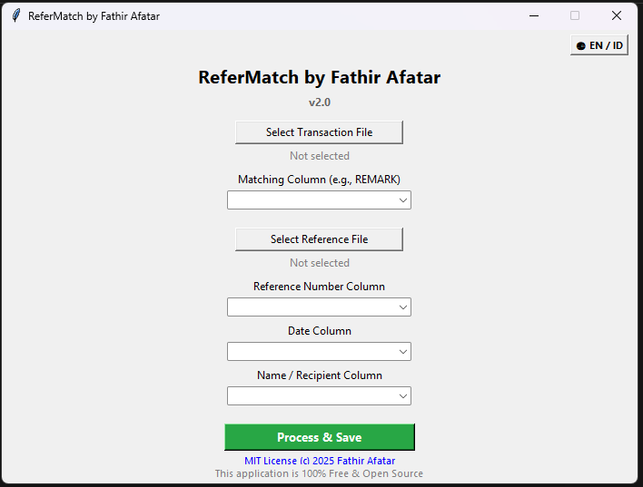
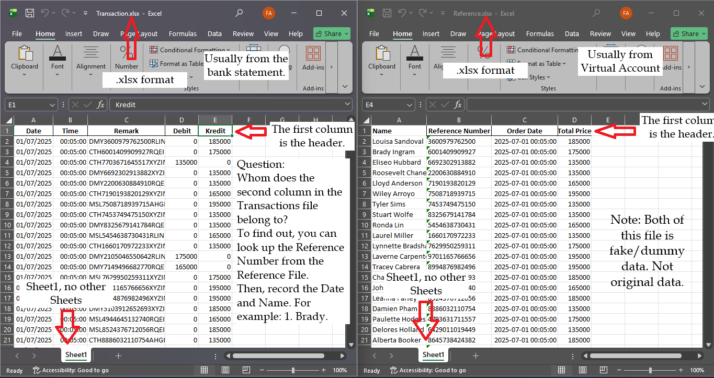
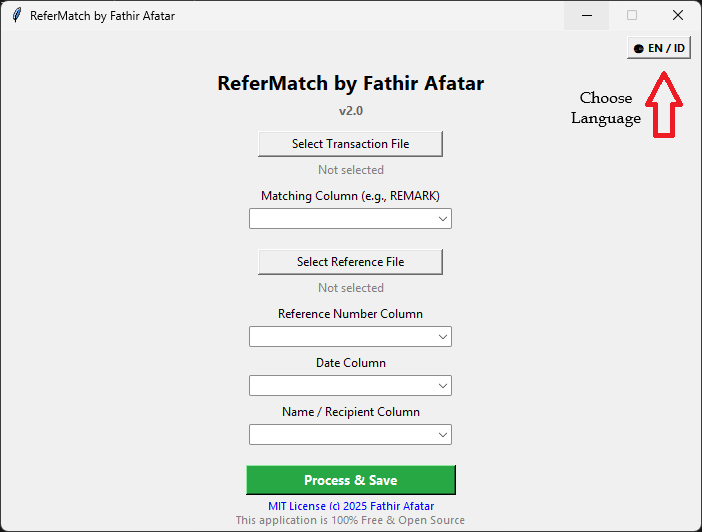
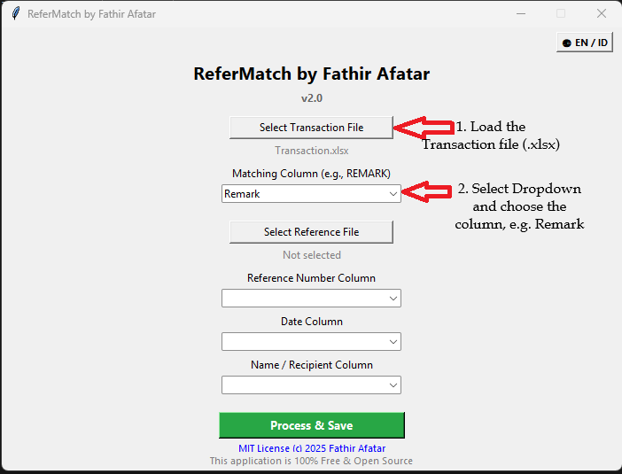
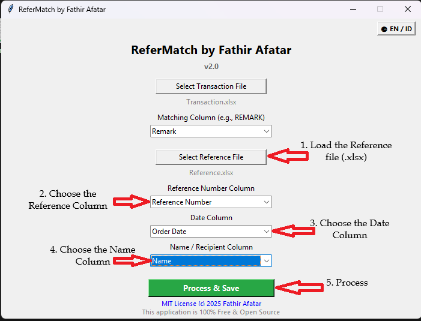
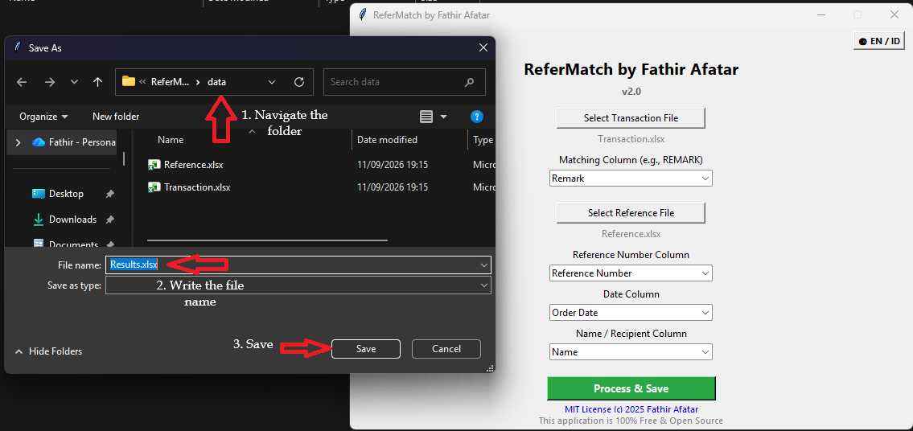
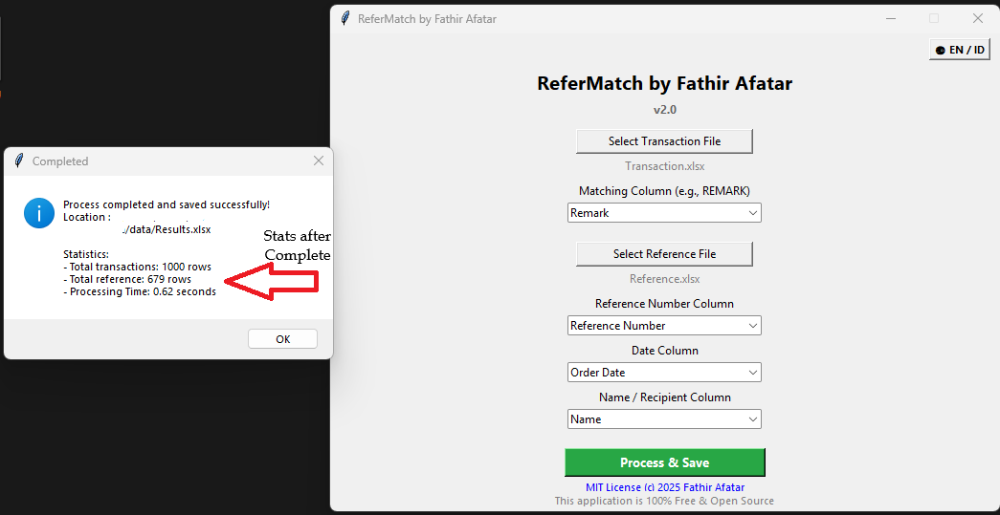
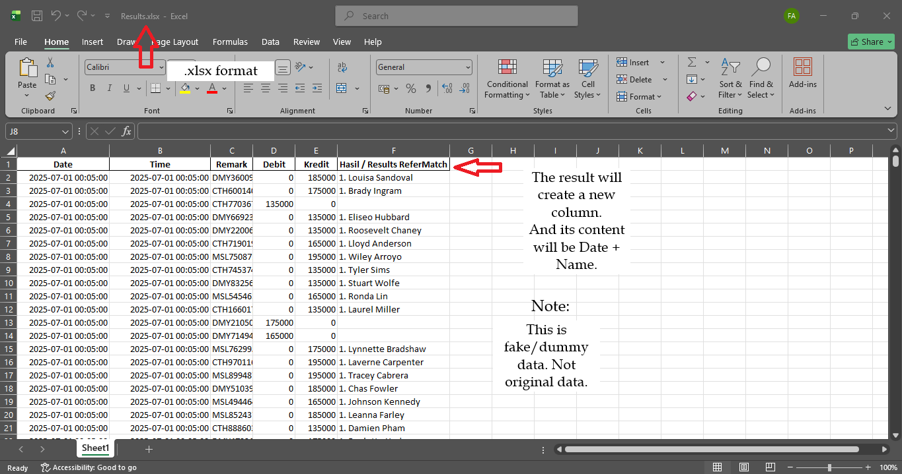

# ReferMatch — Automated Transaction Reference Reconciliation


> Created by **Fathir Afatar**

An automated reconciliation tool designed to eliminate manual data matching across financial spreadsheets.

---

## 📌 Overview

**ReferMatch** was born out of a real-world office challenge: comparing scattered transaction records from different sources to answer one vital question—*do these transaction references actually match?*. Like example transaction from Bank Ledger to Virtual Account.

Built with Python, this lightweight desktop tool automates the process of comparing bank transaction data against payment reference sheets, saving hours of tedious manual cross-checking.

---
## 📸 Preview


---

## ⚡ Performance Metric

Manual reconciliation vs. ReferMatch automation:

| Metric | Manual Reconciliation | ReferMatch (Automated) |
| :--- | :--- | :--- |
| **Speed (1 Row)** | ~15 seconds | **< 1 Second**|
| **Speed (600+ Rows Reference)** | ~2.5 hours (assuming the time is constant) | **< 1 Second** |
| **User Effort** | High (manual CTRL+C, CTRL+F and type date + name / line-by-line checks) | **Low (One-click execution)** |
| **Accuracy** | High risk of human fatigue & oversight | **100% Deterministic Matching** |

> Manual Reconciliation, using CTRL + C to copy the reference number, e.g Virtual Account number and CTRL + F to find the matching number on Bank Ledger (Remark) or sometimes is Bank Statement.

---

## ✨ Key Features

- **Dual-XLSX Input:** Compare bank records against reference files seamlessly.
- **Smart Detection:** Automatically identifies header references and values across sheets.
- **Clear Results View:** Displays match vs. mismatch status in an easy-to-read tabular format.
- **Non-Technical Friendly:** Simple graphical interface (GUI) designed for non-technical office staff.
- **High Performance:** Reconciles 600+ rows of data in under 1 second.
- **100% Free & Open Source:** Released under the MIT License for community use and modification.

> *Note: Actual speed depends on system specs and length of both row. Tested on Intel N100 Processor*
---

---

## 📁 Repository Structure

```text
├── assets/            # Screenshots and media resources
├── dummy_data/        # Sample Excel files for testing and demo
├── src/               # Python source code files
├── LICENSE            # Open-source MIT License
└── README.md          # Project documentation
```

## 🧪 Demo & Sample Data
Testing using dummy data. The file conditions resemble those of actual files.

These sample files mirror real-world financial reports, testing various scenarios:

- Exact Reference & Amount Matches

- Mismatched Values / Unmatched References

- Missing / Null Data Cases

## 🚀 Getting Started
Prerequisites
- Python 3.x installed on your machine.

## ⛔ Current Limitations
- File Format: Currently supports `.xlsx` files only (older `.xls` or PDF tables are not supported).

- Single Sheet Processing: Processes the primary active sheet in each workbook.

- The transaction file requires a minimum of one column, while the reference file requires three columns: reference number, date, and name.



# How to Use Refermatch by Fathir
This step using the v.2.0 version.

**Using the Relase version**

---
1. **Choose Language on top right corner [Indonesia (IN) or English (EN)] (Default = IN)

---

2. Click the **Select Transaction File** button to select the Excel file and Choose the column.


---

3. Click the **Select Reference File** button to select the Excel file, choose the column and began the Process.


---

4. If successful, there is a new dialog windows to save the new file.


> *Success dialog*

5. After Completion, the new dialog windows about the Stats will Show.

> *Stats Dialog, show about 1000 rows of Transaction and 679 rows only take 0.62 seconds*

6. A new column will appear containing the matching results, which consist of a combination of the date and the name.

---
or

1. **Clone This Repository**

```bash
git clone https://github.com/Fathir-Afatar/transaction-reconcile-by-Fathir-Afatar.git
```
2. **Navigate to source folder**

```bash
cd transaction-reconcile-by-fathir\src
```

3. **Run.** (For testing)
```bash
python refermatch_main.py
```

## 📜 Changelog
Format : [Version] - Date
## [v2.0] - 2026-08-31

### Added
- Indonesian and English Language

- Reference Stats 

## [v1.0] - 2025-06-23

### Added
- Core reconciliation engine for dual .xlsx files.

- Automated reference and amount detection.

- Interactive GUI table for results display.

- Included sample dummy data suite.

---

## 📄 License
This project is licensed under the [MIT License](./LICENSE). You are free to use, modify, and distribute it, provided original attribution is given to Fathir Afatar.

---

## 💬 Contributing & Support
Suggestions, bug reports, and pull requests are always welcome!

Check out the GitHub Repository to contribute.

If this tool helped streamline your workflow, please consider giving it a ⭐ on GitHub!